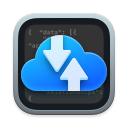

<p align="center">
  
</p>

<h1 align="center">ReqRes</h1>

<p align="center">An HTTP and HTTPS debugging proxy for macOS, built for you and for the coding agent you run against your own backend.</p>

<p align="center">
  <a href="https://github.com/teologov/ReqRes/releases/latest"></a>
  
  <a href="LICENSE.md"></a>
</p>

Capture starts from one control, with no proxy settings to change or undo. While it runs, a network extension points the Mac's system proxy at ReqRes; macOS takes the setting back when capture stops. ReqRes decrypts HTTPS with a certificate created on your Mac, shows which app sent each request, and changes traffic with rules and breakpoints. A built-in MCP server lets Claude Code, Cursor or another MCP client read that traffic and propose changes. By default, ReqRes asks you before an agent's change takes effect.

[Website](https://reqresapp.com) · [Documentation](https://reqresapp.com/docs/) · [Download the latest release](https://github.com/teologov/ReqRes/releases/latest) · [Pricing](https://reqresapp.com/pricing/) · [What's new in 1.1](https://reqresapp.com/docs/reference/whats-new-1-1/)

<picture>
  <source media="(prefers-color-scheme: dark)" srcset="https://reqresapp.com/assets/images/features/traffic-inspector-dark@2x.png">
  
</picture>

## Requirements

- macOS 14.6 or later.
- A universal binary for Apple silicon and Intel. Intel Macs are not regularly tested.
- ReqRes must run from /Applications. With System Integrity Protection on, macOS loads a system extension only from a Developer ID signed, notarized app there.
- No account. The free version needs no licence; activating a Pro key needs an internet connection.
- Not on the App Store. ReqRes ships as a notarized DMG on GitHub Releases and updates itself with Sparkle.

## Install

1. Download the DMG from the [latest release](https://github.com/teologov/ReqRes/releases/latest) and move ReqRes to /Applications.
2. Open it and click Continue with Free Version on the ReqRes Pro window. ReqRes asks macOS to install its network extension, and macOS reports that a system extension needs your approval.
3. Approve it in System Settings ▸ General ▸ Login Items & Extensions ▸ Network Extensions: click the ⓘ button, switch ReqRes on, click Done. On macOS 14 the pane is Privacy & Security ▸ Extensions.
4. Allow the VPN configuration macOS asks to add. It lets the extension set the system proxy; no VPN server is involved.
5. In Settings ▸ Certificate, install the certificate on the Keychain row, then trust it on the Trust row; macOS asks for your password. Until then HTTPS is relayed as one row per connection, not read.
6. Start capture. HTTP requests appear at once; HTTPS connections appear as relayed rows until the certificate is trusted, then as decrypted requests.

Step 3 is easy to miss. The switch is behind the ⓘ button, not on the row itself.

ReqRes rechecks its setup every couple of seconds while it is incomplete. If it shows Restart your Mac to finish, restart once (Restart Now does it); restarting ReqRes alone does not load the new extension. If nothing appears, run Capture ▸ Diagnose Setup…. Closing the window does not stop capture; the menu bar item shows a filled dot while it runs, and quitting stops it. Updates arrive through Sparkle (ReqRes ▸ Check for Updates…) and do not depend on a licence.

Deleting the app removes neither the certificate nor your trust of it. The ? button in Settings ▸ Certificate shows how to remove it by its fingerprint.

## What it does

- **One-click capture.** The toolbar button, ⌘⇧C, the menu bar item or the `start_capture` tool starts it. Apps that read the macOS system proxy are captured with no per-app setting. That covers Safari, Mail, Xcode and other apps on Apple's networking stack, Electron apps, Chromium browsers and Python's urllib. Programs that ignore the system proxy are invisible until you point them at ReqRes; see [Command-line tools and coding agents](#command-line-tools-and-coding-agents).
- **HTTPS decrypted with a certificate made on your Mac.** ReqRes creates its own certificate authority the first time it runs, a different one on every Mac. You install and trust it in Settings ▸ Certificate. Until then, HTTPS passes through untouched and is listed as one row per connection. Plain HTTP needs no certificate, on any port.
- **One row per request, with the app that sent it.** Code, method, URL, destination country, time and duration; the App column names the process, with its pid and path on hover. A slow request or a stream is listed while it is still open. Failed, aborted and timed-out requests are rows that say why. The list keeps the 5,000 most recent requests in memory; nothing is kept on disk unless you save it.
- **Inspector.** The request has Summary, Body, Headers, Metrics and cURL tabs. The response has Summary, Body, Headers and Metrics, plus Events, Messages and RPC tabs where they apply. Bodies are shown decoded from gzip, deflate, brotli and zstd, with JSON rendering, in-body search and image preview.
- **Search with tokens.** Free text plus `host:`, `method:`, `status:`, `path:`, `app:`, `pid:`, `country:`, `outcome:`, `grpc:` and `proto:`. Chips of one kind are OR-ed; different kinds are AND-ed.
- **Rules: Override, Extend and Map Local.** An Override with a body, or a Map Local file, is answered by ReqRes; the request never reaches the server. Extend forwards the request and adds or replaces headers, the status or the body. A rule belongs to one host filter and matches a method and a wildcard or regex URL pattern. The ? button beside the URL field tests a pattern before you save.
- **Breakpoints hold a request.** Settings ▸ Breakpoints holds a request to a host, with optional path text and methods, before it reaches the server. It works over HTTPS and plain HTTP alike. You read its head, edit headers or the body, resume it, or abort it with a status. After 60 seconds ReqRes sends it on unchanged. Requests only: there are no response breakpoints.
- **WebSocket messages, streams and gRPC.** The Messages tab lists a WebSocket's messages both ways. An SSE or NDJSON stream grows while it runs, and an Anthropic or OpenAI answer is put back together. gRPC-Web and Connect calls are decoded without a schema; native gRPC needs the HTTP/2 beta.
- **Saved sessions, HAR, replay and diff.** Right-click a request to save it; Window ▸ Saved Sessions (⌘⇧S) browses and deletes saved ones. HAR 1.2 export, replay and diff exist as MCP tools, not as buttons in the window.
- **Destinations.** Window ▸ Destinations (⌘⇧D) plots the countries requests went to on an Apple Maps world map, from a bundled offline IP table. No address is looked up online; Apple receives only the map area shown.
- **Excluded hosts and pinned apps.** A host on the exclusion list is relayed untouched and never recorded; `timestamp.apple.com` and `*.ls.apple.com` are on it by default. `reqresapp.com` is excluded permanently, so ReqRes's own licence check is never captured or rewritten. Services macOS pins, such as iCloud and the App Store, are relayed from the first connection. An app that refuses the ReqRes certificate fails once and is remembered per app and domain. Its later connections there are relayed as rows marked SSL pinned.
- **Built-in Help and Diagnose Setup.** Help ▸ ReqRes Help (⌘?) has eleven topics. Capture ▸ Diagnose Setup… runs ordered checks, from the app's location to the certificate's trust, and names the first thing that is broken.

<picture>
  <source media="(prefers-color-scheme: dark)" srcset="https://reqresapp.com/assets/images/features/destinations-map-dark@2x.png">
  
</picture>

## Protocol support

One table, the same one Help, `capture_status` and `diagnose_setup` print. Relayed means passed through untouched and listed as one row per connection, never read.

| Protocol | Status | Notes |
|---|---|---|
| HTTPS (HTTP/1.1) | Captured | One row per request with the body decoded, once the certificate is trusted. |
| HTTPS before the certificate is trusted | Relayed | Host, port, bytes each way and duration; nothing is decrypted. |
| Plain HTTP, any port | Captured | Rules, mocks and breakpoints apply; no certificate needed. Browsers never send localhost to a proxy. |
| HTTP/2 | Beta, off by default | Settings ▸ Capture ▸ Capture HTTP/2 (beta). Off, both sides speak HTTP/1.1 to ReqRes and a client that speaks only HTTP/2 fails. On, one row per request, trailers kept. |
| WebSocket (ws:// and wss://) | Captured | The handshake is a row; the Messages tab lists messages both ways, the first 200 and the last 2,000 per connection. wss:// needs the trusted certificate. |
| Server-sent events and NDJSON | Captured | A row that grows while the stream runs; each event numbered. |
| gRPC-Web and Connect | Captured | One row per call with its messages and its own status; no .proto needed. |
| Native gRPC | Beta | Needs the HTTP/2 beta and a client pointed at the proxy with the environment lines. |
| HTTP/3 (QUIC) | Not captured | UDP never passes through the proxy. Turn QUIC off in the browser to see those requests over TCP. |
| Other protocols through the proxy (SSH, databases) | Relayed | One row per connection, not decoded. SOCKS, UDP and DNS never reach ReqRes. |
| Excluded hosts | Not captured | No row, no rules, no breakpoints. |
| Apps that pin their certificate | Relayed | The first request fails; the app is then remembered for that domain, and its later connections there are rows marked SSL pinned. Settings ▸ Capture ▸ SSL-pinned apps lists the remembered apps. |
| Apple services macOS pins (iCloud, the App Store, Software Update) | Relayed | Rows marked SSL pinned by macOS from the first connection; the service keeps working. |
| Servers that require a client certificate (mTLS) | Not captured | The request fails with a 502 that names the reason; exclude the host to pass it through. |
| Tools that ignore the system proxy | Not captured | curl, git, node, Go, Rust, Docker containers: see the next section. |

## Command-line tools and coding agents

curl and git (Apple's included), the Claude Code CLI, node, Go and Rust programs and processes inside Docker containers ignore the macOS system proxy. Their traffic is not in the list, not even as Unknown, until they are pointed at ReqRes. Settings ▸ Capture has both halves of that. Export CA Certificate… writes `reqres-ca.pem`, the certificate only and never its key. The Copy button beside the environment lines gives a block for the terminal you run the tool from. ReqRes fills in your port and the exported path. With the default port and a file in your home folder, the block reads:

```sh
export HTTPS_PROXY=http://127.0.0.1:8034 https_proxy=http://127.0.0.1:8034
export HTTP_PROXY=http://127.0.0.1:8034 http_proxy=http://127.0.0.1:8034
export NO_PROXY=localhost,127.0.0.1,::1
export no_proxy=localhost,127.0.0.1,::1
export NODE_USE_ENV_PROXY=1
export NODE_EXTRA_CA_CERTS=/Users/you/reqres-ca.pem
export SSL_CERT_FILE=/Users/you/reqres-ca.pem
export REQUESTS_CA_BUNDLE=/Users/you/reqres-ca.pem
```

The proxy address starts with `http://` even for HTTPS traffic. The lines work only while capture runs; with capture stopped, requests from that terminal fail until you unset them. localhost is left out of the proxy on purpose (NO_PROXY), so a local backend called from that terminal is not listed. Browsers and Electron apps never send localhost to a proxy either. A connected agent gets the same block from the `capture_environment` tool.

The proxy port is 8034 by default; Settings ▸ Capture changes it (1024 to 65535). A busy port is reported with the program holding it, and the next free port is offered; ReqRes never moves by itself.

## Connect an AI agent

ReqRes ships an MCP server as a stdio helper at `ReqRes.app/Contents/MacOS/reqres-mcp`. It talks to the running app over 127.0.0.1, so ReqRes has to be open. Settings ▸ MCP shows this configuration with the path filled in, and copies it:

```json
{
  "mcpServers": {
    "reqres": {
      "command": "/Applications/ReqRes.app/Contents/MacOS/reqres-mcp",
      "args": []
    }
  }
}
```

For Claude Code, one command does the same:

```sh
claude mcp add --scope user reqres "/Applications/ReqRes.app/Contents/MacOS/reqres-mcp"
```

Claude Desktop reads the JSON from its config file (Settings ▸ Developer ▸ Edit Config) and Cursor from `~/.cursor/mcp.json`; any client that starts a stdio MCP server takes the same shape. Settings ▸ MCP has the steps for Claude Desktop and Claude Code. Then ask the agent to call `capture_status`; it reports capture, the extension, the certificate, the proxy address and the protocol table.

An example turn, with capture running. You ask the agent to catch the request Safari makes when you reload a tab, then make that endpoint return an empty list. It calls `wait_for_session` with the host while you reload, reads the body's shape with `query_session_body`, and proposes a rule with `mock_from_session`. ReqRes shows the approval panel, titled Rewrites live traffic. After Allow, the endpoint is answered by ReqRes and the server is not contacted.

33 tools, all in the free version: 18 reads and 15 writes. The full reference is at https://reqresapp.com/docs/ai-agents/tools/.

| Kind | Tools |
|---|---|
| Reads (never ask) | `capture_status`, `diagnose_setup`, `capture_environment`, `list_sessions`, `get_session`, `query_session_body`, `wait_for_session`, `wait_for_sessions`, `diff_sessions`, `list_messages`, `wait_for_message`, `list_hosts`, `list_rules`, `test_pattern`, `list_saved_sessions`, `get_saved_session`, `list_paused_requests`, `list_destinations` |
| Writes (approval rules below) | `add_host`, `remove_host`, `create_rule`, `update_rule`, `delete_rule`, `mock_from_session`, `start_capture`, `stop_capture`, `clear_sessions`, `export_sessions`, `save_session`, `delete_saved_session`, `replay_request`, `answer_paused_request`, `exclude_host` |

- **Reads are redacted.** Header, query, JSON, form and XML names such as authorization, cookie, token, password and apikey are masked before they leave ReqRes. So are vendor-prefixed keys (`sk_live_`, `ghp_`, `AKIA` and others) and JWTs, wherever they appear. Settings ▸ MCP ▸ Redaction ▸ Send unmasked lifts that for one host at a time; there is no global off switch.
- **Writes ask first, by default.** The changes of one agent turn appear in one approval panel with Allow, Allow for This Session and Deny. Its title names the heaviest change in the batch:
  - Changes what ReqRes watches
  - Writes captured traffic to a file
  - Rewrites live traffic
  - Deletes data
  - Sends a real request to another server
- **Nothing changes until you answer.** After 45 seconds the agent gets `consent_timeout`, nothing changes, and it may ask again. Allow for This Session lifts the panel for ordinary changes until ReqRes quits. So does turning on Let agents change rules and hosts without asking in Settings ▸ MCP. `replay_request` and `exclude_host` always ask. `answer_paused_request` is never asked per call: its grant is Let agents answer held requests in Settings ▸ Breakpoints, off by default.
- **Agent actions are logged.** Settings ▸ MCP ▸ Activity keeps them, with Undo on reversible rows and an export. The Enable the AI bridge switch is the kill switch; it is on by default.
- **Same limits as you.** Agent writes obey the free version's limits; there is no separate quota for automation.
- **Loopback only.** The server listens on 127.0.0.1 while ReqRes runs, and a client must read ReqRes's own handshake file to connect.

## Free version and Pro

The free version has every feature. Pro lifts three limits:

| | Free | Pro |
|---|---|---|
| Host filters | 2 | Unlimited |
| Rules (Extend, Override and Map Local) | 1 in total | Unlimited |
| HTTPS inspections in the detail pane | 10 per launch | Unlimited |

Capture, the traffic table, plain HTTP, relayed and failed rows, and all 33 MCP tools are free. An agent's writes meet the same three limits. The 10 inspections reset at every launch; relayed and failed rows never count.

**ReqRes Pro is $60 per person, paid once, for up to 2 Macs at once.** A licence is yours permanently, with every future version included. Refunds within 14 days, for any reason. Prices exclude VAT and sales tax; volume pricing from 5 licences is on the pricing page. Checkout is at https://reqresapp.com/pricing/, never in the app. The key arrives by email; activate it in the ReqRes Pro window or in Settings ▸ License. Settings ▸ License also has Deactivate this Mac and Manage your Macs, for moving a licence between Macs. There is no trial clock and no in-app purchase: the free version is the trial.

## Privacy and security

What leaves your Mac, and when:

| Data | Goes to | When |
|---|---|---|
| The map area you view, never a request's address | Apple Maps | While the Destinations window is open |
| Crash reports and a 10% sample of performance traces, with no captured traffic | Sentry | While Settings ▸ General ▸ Privacy ▸ Share crash and performance reports is on (the default) |
| Update checks and downloads | raw.githubusercontent.com (the feed) and github.com (the DMG) | On Sparkle's schedule, or when you choose Check for Updates… |
| Your licence key, the Mac's serial number, the app version and a count of licence answers that failed to verify; the Mac's name on activation | reqresapp.com | Only with a licence |
| A replayed request, with its captured credentials | The request's original server | Only after you allow the replay |
| What a connected agent reads, redacted unless the host is under Send unmasked | The agent and its provider | While an agent is connected |

How it is built:

- The proxy and the MCP server listen on 127.0.0.1 only. The app and the extension are both sandboxed, and the channel between them is authenticated.
- ReqRes sends captured traffic nowhere on its own. Crash reports carry no traffic: network breadcrumbs are off in both the app and the extension.
- The certificate authority is created per install: RSA 2,048-bit, SHA-256, valid ten years. Your Mac trusts it for your user account only, for SSL and basic X.509 checks; it cannot sign another CA. Per-site certificates are minted in the extension's memory, valid 90 days, never written to disk. The CA's private key sits in files only your user account can open. The extension receives it in memory when capture starts; it is never sent anywhere.
- Country lookups use a bundled table; the approximate origin on the map comes from the time zone, never Location Services.
- Saved sessions are stored unmasked in ReqRes's database under `~/Library/Group Containers`, readable by anything running as your user. Settings ▸ Storage shows the exact path.

## What ReqRes is not

- Not a packet sniffer, and not a VPN. The extension publishes proxy settings and routes no packets. HTTP/3, SOCKS, UDP and DNS never reach it.
- Not a view of all traffic. Programs that ignore the macOS system proxy (curl, git, node, Go, Rust, Docker containers) are invisible until pointed at ReqRes.
- Not an iOS or device capture tool. The proxy listens on 127.0.0.1 only.
- Not a response interceptor. Breakpoints hold requests; responses change through rules written in advance.
- Not an App Store app, and not a subscription.
- Not fully source-available. The MITM engine, certificate generation, the database and licensing are a closed binary framework; this repository is the shell around it.
- Not cross-platform. macOS 14.6 and later only.
- Not finished with HTTP/2. It is a beta, off by default, and native gRPC depends on it.

## Source and the closed core

This repository is the ReqRes app shell: the window and inspector, settings, Help, the system extension target, the MCP helper and the scripts. The engine is closed. The MITM proxy, certificate generation, the SQLite database and licence enforcement live in `Sources/XReqResCore.xcframework`. That binary framework is committed here and built from a private repository; `Sources/XReqResCore.provenance.json` records which commit built it. The shell uses only the framework's public interface. You can read the code that handles your traffic in the window and over MCP, but not the engine.

## Licence

The source in this repository is licensed under the Functional Source License 1.1 with Apache 2.0 as the future licence (FSL-1.1-ALv2); see [LICENSE.md](LICENSE.md). Each release becomes Apache-2.0 two years after it is first distributed. Until then you may use, copy, modify and redistribute it for any purpose other than a competing commercial product or service. `Sources/XReqResCore.xcframework` is distributed as a binary; its source is not in this repository.

Third-party libraries and the bundled data sources are listed in [NOTICE.md](NOTICE.md) and [LICENSE-THIRD-PARTY.md](LICENSE-THIRD-PARTY.md), and under About ▸ Licenses… in the app. IP geolocation by [DB-IP](https://db-ip.com) (CC BY 4.0); world outlines by Natural Earth (public domain).

## Contributing

Pull requests are accepted for UI fixes only. Changes to the engine belong to the closed core and cannot be accepted here; file an [issue](https://github.com/teologov/ReqRes/issues) instead, engine bugs included. A new source file carries the same licence header as its siblings.

## Build from source

A self-built ReqRes runs as the free version. The closed core checks who signed the app before it accepts a licence. Only builds signed with OloApps' own Developer ID pass, Debug or Release.

You need Xcode and an Apple Developer team. The project signs manually with OloApps' provisioning profiles. Before you build, set the ReqRes and vpn-tunnel targets to your own signing under Signing & Capabilities. The system extension needs the Network Extension entitlement, which Apple grants per team; without it the vpn-tunnel target does not sign. The embedded core was built with Xcode 27 on macOS 27 and the shell builds there; older Xcode versions are untested.

```sh
cp Sources/Config.xcconfig.template Sources/Config.xcconfig   # then fill it in
open Sources/ReqRes.xcodeproj
swift test --package-path Sources/AppServices                 # Utils, MCPKit, GeoKit
```

`Sources/Config.xcconfig` is gitignored and has three keys:

- `DEVELOPMENT_TEAM` (required): your Apple Developer team id. It flows into both Info.plists and the app group id.
- `SENTRY_DSN` (optional): a Sentry DSN without the `https://` prefix. Empty means crash reporting is off.
- `REQRES_SIGN_IDENTITY`: `Developer ID Application` by default. If several valid certificates share that name, put the 40-hex SHA-1 instead (from `security find-identity -v -p codesigning`). Otherwise Xcode may pick one that is not in your provisioning profile.

The app has no tests of its own; the ReqResUITests target is Xcode's empty template. There is no CI; the core's tests live with the core.

Running what you built: with System Integrity Protection on, macOS loads the system extension only from a Developer ID signed, notarized copy in /Applications. A Debug build run from Xcode therefore cannot activate the extension. `Scripts/dev-install.sh` archives, signs, notarizes, staples and installs there. Notarization uses a `reqres-notary` keychain profile from `xcrun notarytool store-credentials`, or an Apple ID and app-specific password in a gitignored `.env`. The script stops a running capture first, because codesign's timestamp request fails through ReqRes's own proxy. The extension's version must be higher than the installed one or macOS keeps the old extension; `Scripts/extension-version-check.sh` checks that. `--no-notarize` builds and installs a copy whose extension will not load.

If the configuration does not load, check that `Sources/Config.xcconfig` exists and has no quotes around values. Check that it is linked under Project ▸ Info ▸ Configurations, then clean the build folder. Build errors about a missing team id mean `DEVELOPMENT_TEAM` is not set. An error naming a missing profile means a target still points at OloApps' profiles.

## Documentation and support

- [Documentation](https://reqresapp.com/docs/): Get started, Inspect traffic, Change traffic, AI agents, Troubleshooting and Reference, including [Supported protocols](https://reqresapp.com/docs/reference/protocols/), [Free version and Pro](https://reqresapp.com/docs/reference/free-and-pro/) and [Data and privacy](https://reqresapp.com/docs/reference/privacy/).
- In the app: Help ▸ ReqRes Help (⌘?).
- [Issues](https://github.com/teologov/ReqRes/issues) for bugs and requests, engine bugs included; those are fixed in the core and shipped here as a new framework.

ReqRes is made by OloApps. Website: https://reqresapp.com.
